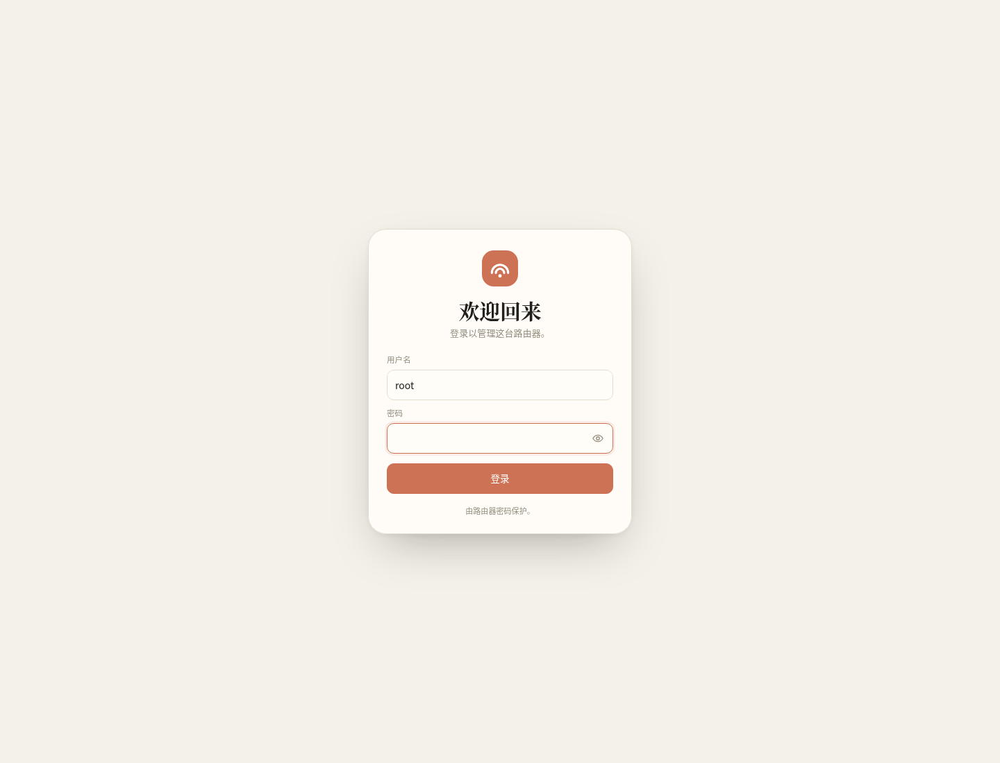
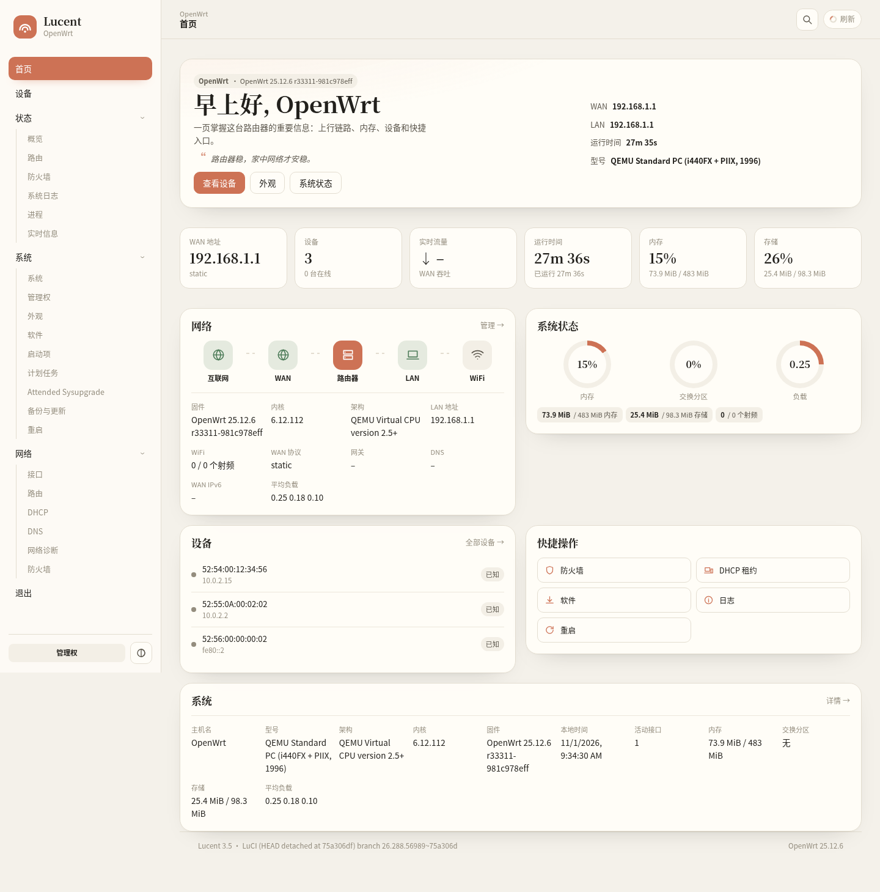
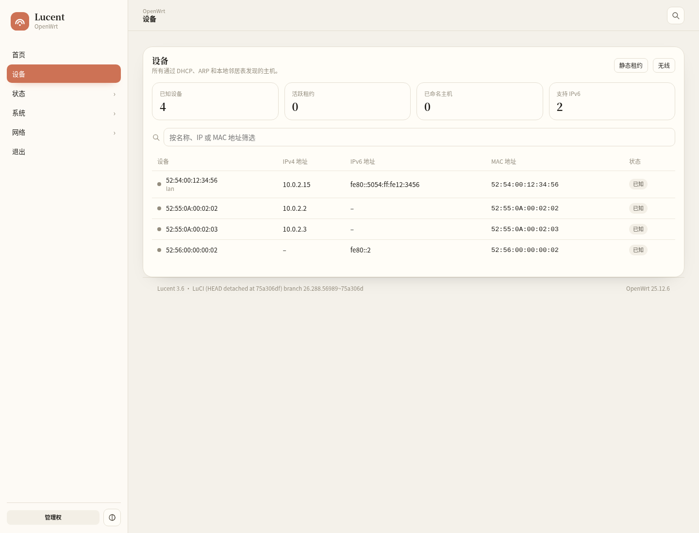
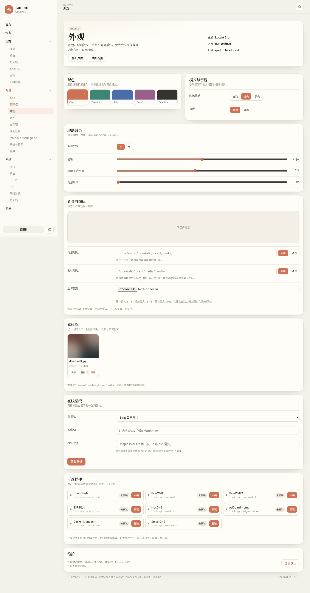
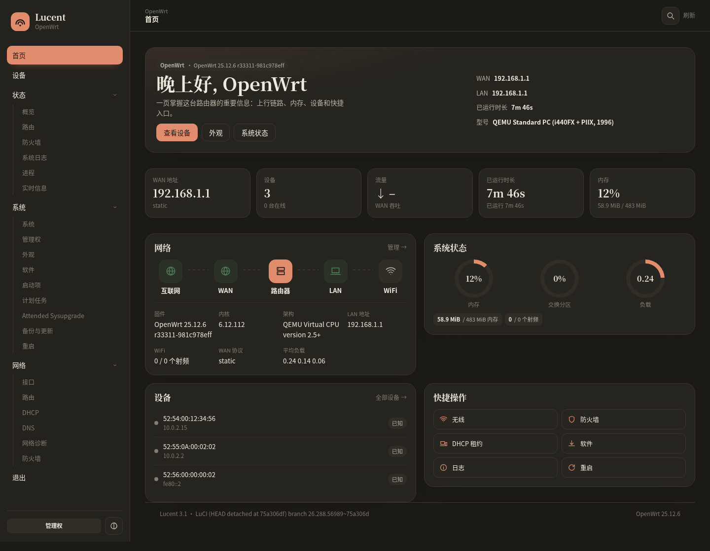
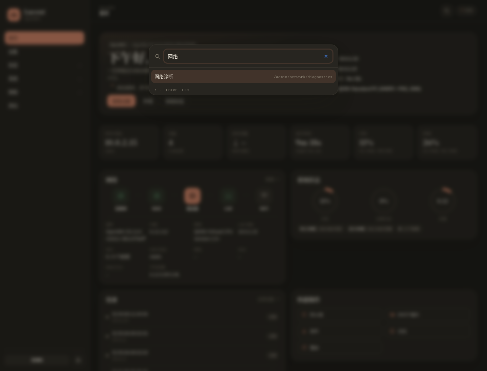
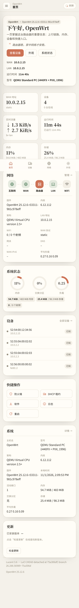

# Lucent 3

An independent LuCI theme for OpenWrt 25.12 (ucode LuCI), written from scratch.
It borrows *feature ideas* from popular LuCI themes — a dashboard, glass
surfaces, a device list and an appearance panel — but shares no templates,
stylesheets, scripts or package metadata with them.

- Target: OpenWrt 25.12.x, LuCI 26.x (ucode)
- Package: `luci-theme-lucent` 3.6.2
- Licence: Apache-2.0

## Screenshots









## Features

**Appearance**
- Five palettes: Clay, Celadon, Mist, Dusk, Graphite
- Light, dark and auto (follows `prefers-color-scheme`)
- Configurable glass blur, surface opacity and wallpaper dimming
- Cozy and compact density
- Background image/video from a URL or the router media library
- Custom sidebar logo (PNG, WebP, ICO or SVG)
- Settings are applied live and saved to `/etc/config/lucent`

**Dashboard** (`/cgi-bin/luci/admin/home`)
- Greeting, hostname, firmware and model
- WAN/LAN addresses, uptime, memory, device count and live WAN
  throughput KPIs, refreshed by polling
- Branching LAN tree: bridge → ports (negotiated speed, up/down) → the hosts
  learned on each, wired from the bridge FDB and wireless from the driver's
  association list; every host leaf links to the devices page
- Top talkers: the busiest hosts right now with proportional bars, plus how
  long the quiet ones have been silent (needs per-device accounting, which is
  off by default — see Appearance)
- Uplink topology (Internet → WAN → router → LAN → Wi-Fi)
- Memory, swap and load rings
- Device list and quick actions
- Wi-Fi radio count and the first configured SSID

**Navigation**
- Grouped sidebar with a mobile drawer, built by the theme itself — no
  dependency on `luci-theme-bootstrap` being installed
- The menu is painted from a per-session copy the moment a page opens, then
  reconciled with the router, so clicking around never leaves an empty column
  while `admin/menu` is still answering
- The sidebar tells you who drew it: `menu:cache+tree 312→1204ms #menu10` on
  the home page and in the footer, so a blank or slow menu can be pinned to a
  layer — router, cache, fallback, or stale JS — without a developer console
- Live status panel docked in the sidebar on every page: animated CPU and
  memory rings, a WAN throughput curve with down/up rates, WAN/LAN addresses,
  uptime, online devices, Wi-Fi, temperature, a storage meter and load /
  conntrack / process tags, refreshed on a tiered 5 s poll
- Collapsible panel (state persists); in the 64 px rail it reduces to the
  two rings
- Command palette: `Ctrl/Cmd+K`, `/`, or the toolbar search button;
  arrow keys + Enter to jump to any visible menu entry
- Simplified Chinese (see below) and English UI

**Devices** (`/cgi-bin/luci/admin/clients`)
- Merges DHCP leases, ARP/neighbour hints and IPv6 addresses
- Search filter, online state, interface name and lease time
- Per-device live down/up rate and last-seen columns, sortable by rate

**Media library**
- Uploads are streamed to `/tmp/lucent-upload/` in 192 KiB chunks and
  validated by magic bytes on the router before being moved to
  `/www/luci-static/lucent/media/`
- Images up to 8 MiB, videos up to 32 MiB, icons up to 1 MiB
- Online wallpapers from Bing, Unsplash (optional API key) and Wallhaven
- Deleting a file that is currently used as background or logo clears the
  reference instead of leaving a broken path

**Chinese UI**
- All Lucent strings have a maintained `zh_Hans` catalog
- `zh_cn` is registered in `/etc/config/luci`; browsers that ask for
  Chinese are served Chinese automatically
- Upstream LuCI core translations are bundled under distinct catalog
  names, so the menu and built-in pages are Chinese without installing
  `luci-i18n-*` language packs
- Backend error messages from `luci.lucent` go through the same catalog
- Force a language with `uci set luci.main.lang=zh_cn && uci commit luci`

**Optional add-ons**
- A fixed allow-list of LuCI applications can be installed from the package
  feeds already configured on the router. The browser cannot pass a shell
  command, package name or URL; only the eight known keys are accepted.

## Requirements

- OpenWrt 23.05 or newer with ucode-based LuCI (25.12 recommended)
- `luci-base`
- `rpcd`, `rpcd-mod-file` (part of the default image)
- For the optional installer: `apk` (25.12+) or `opkg` (23.05/24.10)

## Install

### 一键安装（在线从 GitHub 拉取，推荐）

在路由器 SSH 里执行一行命令即可。脚本会自动下载对应固件的安装包、
检测 `apk`/`opkg`、安装并启用 Lucent、注册中文、清理缓存。

**推荐：用最新发布版的安装脚本**（不受 CDN 缓存影响，永远拿到当前版本的脚本）：

```sh
wget -qO- https://github.com/likz0421/luci-theme-lucent/releases/latest/download/lucent-install.sh | sh
```

**国内用户请用镜像加速**（直连 GitHub 常常很慢或失败）：

```sh
# 国内推荐：脚本走 jsDelivr，安装包自动回退国内镜像
wget -qO- https://cdn.jsdelivr.net/gh/likz0421/luci-theme-lucent@main/install.sh | sh
```

```sh
# 海外 / 可直连 GitHub：
wget -qO- https://raw.githubusercontent.com/likz0421/luci-theme-lucent/main/install.sh | sh
```

> 注意：jsDelivr 对 `@main` 的文件缓存最长 7 天（`max-age=604800`），所以 `@main`
> 路径可能给你一份**旧脚本**。脚本现在会先向 GitHub 的 release 端点确认最新版再下载，
> 因此旧副本也会装上最新版本；但如果你想要脚本本身也是最新的，请用上面的
> `releases/latest/download/lucent-install.sh`。

没有 `wget` 时用 `curl`：

```sh
curl -fsSL https://github.com/likz0421/luci-theme-lucent/releases/latest/download/lucent-install.sh | sh
```

卸载 / 查看状态：

```sh
# 卸载（恢复 Bootstrap，无需联网）
sh install.sh uninstall
# 查看状态
sh install.sh status
```

如果管道方式不便，可先下载脚本再执行：

```sh
wget -qO /tmp/lucent-install.sh https://cdn.jsdelivr.net/gh/likz0421/luci-theme-lucent@main/install.sh
sh /tmp/lucent-install.sh install
```

### 主页在线更新（v3.6.2+）

安装后，登录 LuCI 进入 **首页**，右下角的 **更新** 卡片即可在线检查并升级主题：
点 *检查更新* 对比当前版本与 GitHub 上的最新版（沿用与安装脚本相同的国内镜像
回退），若有新版本点 *更新到 vX* 后台下载安装，进度实时显示，完成后自动刷新页面。
浏览器只触发固定动作，不会传入任何 URL、版本号或命令。

也可在命令行使用同样的能力：

```sh
sh /usr/share/lucent/install.sh check    # 输出 JSON：当前/最新版本、是否有更新
sh /usr/share/lucent/install.sh update   # 在线升级到最新版（已是最新则直接返回）
```

镜像与地址控制（环境变量）：

| 变量 | 作用 |
| --- | --- |
| `LUCENT_CN=1` | 强制优先用国内镜像下载 `.apk`/`.ipk` |
| `LUCENT_BASE_URL=https://你的镜像` | 指定私有 / 内网下载地址 |
| `LUCENT_VERSION` / `LUCENT_TAG` | 覆盖要安装的版本与 Release 标签 |

脚本默认先试直连 GitHub，失败后自动依次回退
`ghfast.top` → `gh-proxy.com` → `mirror.ghproxy.com` → `github.moeyy.xyz`。
若 HTTPS 报错，先装证书：`apk add ca-bundle ca-certificates`（或
`opkg install ca-bundle`）。

`install` 还会先检查 OpenWrt 的 LuCI 界面；若系统缺少 LuCI，会尝试从
路由器已配置的软件源安装 `luci` / `luci-base`（这一步需要能访问软件源）。

### 离线一键（路由器完全无外网时用）

下载 `lucent-offline-install.sh`（自包含，已内嵌 apk/ipk/文件树），传到
路由器执行即可，安装主题本身不需要联网：

```sh
scp lucent-offline-install.sh root@192.168.1.1:/tmp/
ssh root@192.168.1.1 'sh /tmp/lucent-offline-install.sh install'
```

### 手动安装

| 固件 | 文件 |
| --- | --- |
| OpenWrt 25.12 (apk) | `luci-theme-lucent-3.6.2-r1.apk` |
| OpenWrt 23.05/24.10 (opkg) | `luci-theme-lucent_3.6.2-r1_all.ipk` |
| 任意（无包管理器） | `lucent-3.6.2.tar.gz`（解压后 `./install.sh`） |

apk:

```sh
apk add --allow-untrusted ./luci-theme-lucent-3.6.2-r1.apk
```

opkg:

```sh
opkg install ./luci-theme-lucent_3.6.2-r1_all.ipk
```

Manual:

```sh
tar -xzf lucent-3.6.2.tar.gz -C /tmp
cd /tmp/luci-theme-lucent-3.6.2 && ./install.sh
```

The package registers itself as `Lucent` in `/etc/config/luci` and selects
itself on install when Bootstrap is the current theme. You can switch back at
**System → System → Language and Style**. Uninstall with
`apk del luci-theme-lucent`, `opkg remove luci-theme-lucent`, or
`./uninstall.sh` for a manual install. Removal switches
`luci.main.mediaurlbase` back to Bootstrap and deletes the media library.

## Configuration

`/etc/config/lucent`, section `main`:

| Option | Values | Default |
| --- | --- | --- |
| `palette` | `clay`, `celadon`, `mist`, `dusk`, `graphite` | `clay` |
| `mode` | `light`, `dark`, `auto` | `auto` |
| `glass` | `0`, `1` | `1` |
| `glass_blur` | 0–40 (px) | `20` |
| `glass_alpha` | 30–100 (%) | `62` |
| `bg_dim` | 0–100 | `0` |
| `density` | `cozy`, `compact` | `cozy` |
| `background` | URL or `/luci-static/...` path | empty |
| `logo_image` | URL or `/luci-static/...` path | empty |

Everything is also editable in the Appearance page.

## Layout

```
htdocs/luci-static/lucent/            theme.css, logo.svg, media library
htdocs/luci-static/resources/lucent/  core.js, util.js
htdocs/luci-static/resources/view/lucent/
                                      home.js, clients.js, settings.js
ucode/template/themes/lucent/         header.ut, footer.ut, sysauth.ut
root/usr/libexec/rpcd/luci.lucent     media/wallpaper/plugin helper
root/usr/share/rpcd/acl.d/            helper ACL
root/usr/share/luci/menu.d/           menu entries
root/etc/config/lucent                defaults
```

## Build

The repository can be built with the OpenWrt buildroot/SDK by dropping it into
`feeds/luci/themes/` and selecting **Lucent** in `make menuconfig` →
**LuCI → Themes**.

Standalone artifacts (used for the files in `dist/`) are produced with:

```sh
./scripts/build-apk.sh      # requires apk-tools 3 (APK_BIN=/path/to/apk)
./scripts/build-ipk.sh
./scripts/build-tar.sh
./scripts/build-src.sh
./scripts/build-onekey.sh   # 生成在线一键脚本 + 离线自包含脚本
./scripts/checksums.sh
```

## Compared with upstream themes

The theme was designed from the feature set users expect from 7Dollar,
Argon and Fluent, but it is not a drop-in clone. Current status:

| Capability | Lucent 3.1 | Notes |
| --- | --- | --- |
| Dashboard with WAN/LAN, uptime, memory, load | Yes | `/admin/home` |
| Live WAN throughput | Yes | Computed client-side from `wan.statistics` |
| Wi-Fi status / SSID | Yes | Radio count + first SSID |
| Online device list | Yes | DHCP + ARP + IPv6 hints |
| Per-device live rate / last seen | Yes | conntrack accounting diff, opt-in via Appearance |
| Branching LAN topology | Yes | bridge → ports → hosts, FDB + association list |
| Grouped menu + keyboard search | Yes | Sidebar groups, `Ctrl/Cmd+K` palette |
| Live readings in the sidebar | Yes | CPU/memory rings, traffic curve, WAN/LAN, uptime, devices, Wi-Fi, temperature, storage |
| Multiple palettes / dark mode / glass | Yes | 5 palettes, auto mode, adjustable blur |
| Chinese localization | Yes | Own catalog + bundled LuCI core catalogs |
| Media library / wallpapers / custom logo | Yes | Magic-byte validated uploads |
| Responsive mobile layout | Yes | Drawer below 900 px |
| Native LuCI page compatibility | Yes | Uses the standard theme contract |
| Latency / ping probe | **No** | Not implemented; would need a small helper |
| OpenClash status card | **No** | Not implemented; avoids coupling to one add-on |
| One-command installer | Yes | 在线 `install.sh`（GitHub+镜像）与离线 `lucent-offline-install.sh` |

So: the visible core of the upstream dashboard is covered, but latency
probing and an OpenClash-specific card are deliberately still missing. They
are the two remaining feature gaps, not hidden claims of full parity.

## Security notes

- Uploads are written through the standard `file` ubus object into
  `/tmp/lucent-upload/`; the helper then re-checks size, extension and magic
  bytes before moving the file into the web root.
- The helper never evaluates browser-supplied shell text. Wallpaper providers
  and package names are selected from fixed lists.
- Removing the package removes the theme, its views, helper, ACL and the
  uploaded media library (`/www/luci-static/lucent`). Media survives package
  upgrades so a background does not disappear after `apk upgrade`.

## Provenance

Lucent 3 is a clean-room rewrite produced for this project. Its templates,
CSS, JavaScript and shell helper were written specifically for Lucent and do
not derive from `luci-theme-7dollar`, `luci-theme-argon`, `luci-theme-fluent`
or any other theme source tree. Chinese translation data for LuCI core
pages comes from the upstream `luci-i18n-base-zh-cn` and
`luci-i18n-firewall-zh-cn` packages (Apache-2.0), renamed to avoid file
conflicts and documented in `i18n/README-upstream.md`; that data is not
theme code. Those projects were consulted only to decide
which user-facing capabilities are worth offering (dashboard, palettes,
glass surfaces, device overview, media settings). The LuCI integration points
(`header.ut`/`footer.ut`/`sysauth.ut`, `.cbi-*` selectors, `L.require`,
`rpc.declare`) are the documented interfaces every LuCI theme must implement.
